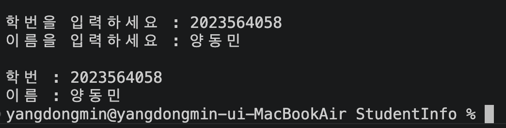

### [입원으로 인한 유고결석으로 11/12 정상 제출]

# 학번과 이름 출력하기 (x86-64 Assembly)

학번과 이름을 **입력받아** 콘솔에 출력하는 어셈블리 프로그램입니다.

## 개발 환경

| 항목 | 내용 |
| --- | --- |
| OS | macOS (Apple Silicon, Rosetta 2로 x86-64 실행) |
| 어셈블러 | Apple clang 15 (GNU as 호환, Intel 문법) |
| 아키텍처 | x86-64 |
| 입출력 | C 표준 라이브러리 `scanf` / `printf` (Irvine32 대신 사용) |

> MASM과 Irvine32는 Windows 전용이라 macOS에서 실행할 수 없습니다. 그래서 같은 x86 명령어를 사용하면서 clang 어셈블러로 작성했습니다.

## 빌드 및 실행

```bash
clang -arch x86_64 info.s -o info
./info
```

## 실행 화면



## 코드 설명

전체 코드는 [info.s](info.s)에 있습니다.

### 1. 데이터 정의

```assembly
BUF_SIZE = 64                           # 입력 버퍼 크기

    .section __TEXT,__cstring
promptId:   .asciz "학번을 입력하세요 : "
promptName: .asciz "이름을 입력하세요 : "
fmtIn:      .asciz " %63[^\n]"          # 앞 공백/개행 건너뛰고 줄 끝까지 최대 63자
fmtOut:     .asciz "\n학번 : %s\n이름 : %s\n"

    .section __DATA,__data
studentId:  .space BUF_SIZE             # 학번 입력 버퍼
name:       .space BUF_SIZE             # 이름 입력 버퍼
```

* `.asciz` 는 문자열 끝에 널 바이트(0)를 자동으로 붙입니다. MASM의 `BYTE "...",0` 과 같습니다.
* `.space 64` 는 64바이트를 0으로 채운 버퍼입니다. MASM의 `BYTE 64 DUP(0)` 과 같습니다.
* 형식 문자열 `" %63[^\n]"` 의 의미
  * 맨 앞 공백: 이전 입력에서 남은 개행 문자(Enter)를 건너뜁니다.
  * `[^\n]`: 개행 문자가 나오기 전까지 모두 읽으므로 이름에 공백이 있어도 됩니다 (예: `Yang Dong Min`).
  * `63`: 버퍼 크기(64) − 널 바이트 1 → 버퍼 오버플로를 막습니다.
* 한글은 UTF-8로 저장되어 한 글자가 3바이트를 차지합니다.

### 2. 입력 (scanf 호출)

```assembly
    lea   rdi, [rip + promptId]         # printf("학번을 입력하세요 : ")
    xor   eax, eax
    call  _printf

    lea   rdi, [rip + fmtIn]            # scanf(" %63[^\n]", studentId)
    lea   rsi, [rip + studentId]
    xor   eax, eax
    call  _scanf
```

* 안내 문구를 출력한 뒤 `scanf` 로 버퍼에 문자열을 저장합니다. 이름도 같은 방식으로 입력받습니다.
* `scanf` 의 두 번째 인자(`RSI`)에는 값이 아니라 **버퍼의 주소**를 전달합니다.

### 3. 출력 (printf 호출)

```assembly
    lea   rdi, [rip + fmtOut]           # 1번째 인자: 형식 문자열
    lea   rsi, [rip + studentId]        # 2번째 인자: 학번
    lea   rdx, [rip + name]             # 3번째 인자: 이름
    xor   eax, eax                      # AL = 사용한 XMM 개수 (0)
    call  _printf                       # printf(fmtOut, studentId, name)
```

* System V AMD64 호출 규칙에 따라 인자를 `RDI`, `RSI`, `RDX` 순서로 전달합니다.
* `LEA` 와 `[rip + label]` (RIP 상대 주소 지정)로 문자열의 주소를 가져옵니다. MASM의 `mov edx, OFFSET label` 과 같은 역할입니다.
* `printf` / `scanf` 는 가변 인자 함수이므로 `AL` 에 사용한 XMM 레지스터 개수(0)를 넣어야 합니다.
* `main` 시작 시 `push rbp` 로 `RSP` 를 16바이트 정렬한 뒤 함수를 호출합니다.

### MASM과 비교

| MASM (Irvine32) | 이 프로그램 |
| --- | --- |
| `.data` / `.code` | `.section __DATA,__data` / `.section __TEXT,__text` |
| `BYTE 64 DUP(0)` | `.space 64` |
| `call ReadString` | `call _scanf` |
| `BYTE "...",0` | `.asciz "..."` |
| `mov edx, OFFSET msg` + `call WriteString` | `lea rdi, [rip + msg]` + `call _printf` |
| `main PROC` ... `main ENDP` | `_main:` ... `ret` |
