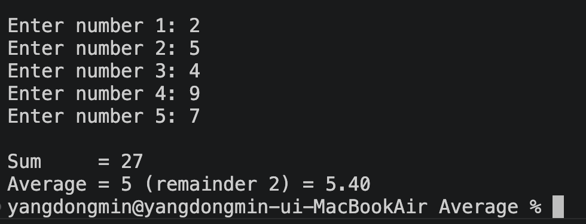

# 5개 숫자의 평균 구하기 (x86-64 Assembly)

정수 5개를 입력받아 **합계**와 **평균**을 출력하는 어셈블리 프로그램입니다.

## 개발 환경

| 항목 | 내용 |
| --- | --- |
| OS | macOS (Apple Silicon, Rosetta 2로 x86-64 실행) |
| 어셈블러 | Apple clang 15 (GNU as 호환, Intel 문법) |
| 아키텍처 | x86-64 |
| 입출력 | C 표준 라이브러리 `scanf` / `printf` (Irvine32 대신 사용) |

> MASM과 Irvine32는 Windows 전용이라 macOS에서 실행할 수 없습니다. 그래서 같은 x86 명령어를 사용하면서 clang 어셈블러로 작성했습니다.

## 빌드 및 실행

```bash
clang -arch x86_64 avg.s -o avg
./avg
```

## 실행 화면



```
Enter number 1: 10
Enter number 2: 20
Enter number 3: 30
Enter number 4: 40
Enter number 5: 55

Sum     = 155
Average = 31 (remainder 0) = 31.00
```

```
Enter number 1: 1
Enter number 2: 2
Enter number 3: 3
Enter number 4: 4
Enter number 5: -3

Sum     = 7
Average = 1 (remainder 2) = 1.40
```

## 코드 설명

전체 코드는 [avg.s](avg.s)에 있습니다.

### 1. 숫자 5개 입력 (반복문)

```assembly
InputLoop:
    lea   rdi, [rip + prompt]           # printf("Enter number %d: ", i+1)
    lea   esi, [rbx + 1]
    xor   eax, eax
    call  _printf

    lea   rdi, [rip + fmtIn]            # scanf("%d", &nums[i])
    lea   rsi, [rip + nums]
    lea   rsi, [rsi + rbx*4]            # 주소 = nums + i * 4
    xor   eax, eax
    call  _scanf

    lea   rcx, [rip + nums]
    add   r12d, DWORD PTR [rcx + rbx*4] # sum += nums[i]

    inc   ebx                           # i++
    cmp   ebx, COUNT
    jl    InputLoop                     # i < 5 이면 반복
```

* `RBX`는 인덱스 `i`, `R12`는 합계 `sum`으로 사용합니다. 두 레지스터는 함수 호출 후에도 값이 보존되는 레지스터(callee-saved)이므로 `printf`/`scanf`를 호출해도 값이 바뀌지 않습니다.
* `[rsi + rbx*4]` 는 **베이스-인덱스 피연산자**(스케일 팩터 4)입니다. DWORD 배열의 `i`번째 원소 주소를 계산합니다.
* `cmp` + `jl` 로 `i < 5` 동안 반복합니다.

### 2. 평균 계산

```assembly
    mov   eax, r12d                     # EDX:EAX = sum (부호 확장)
    cdq
    mov   ecx, COUNT
    idiv  ecx                           # EAX = 몫, EDX = 나머지

    cvtsi2sd xmm0, r12d                 # xmm0 = (double)sum
    cvtsi2sd xmm1, ecx                  # xmm1 = 5.0
    divsd    xmm0, xmm1                 # xmm0 = sum / 5.0
```

* **정수 평균:** `CDQ`로 EAX를 EDX:EAX로 부호 확장한 뒤, `IDIV`로 나누면 몫은 EAX, 나머지는 EDX에 저장됩니다. 음수 입력도 처리할 수 있도록 부호 있는 나눗셈(`IDIV`)을 사용했습니다.
* **실수 평균:** `CVTSI2SD`로 정수를 double로 변환하고 `DIVSD`로 나눠 소수점 둘째 자리까지 출력합니다.

### 3. 함수 호출 규칙 (System V AMD64)

| 인자 | 레지스터 |
| --- | --- |
| 1~3번째 정수/포인터 | `RDI`, `RSI`, `RDX` |
| 실수 | `XMM0` |
| 가변 인자 함수(`printf`)의 `AL` | 사용한 XMM 레지스터 개수 |

* 함수를 호출할 때 `RSP`는 16바이트 정렬되어 있어야 합니다. `main` 시작 시 `push` 3번(rbp, rbx, r12)으로 정렬을 맞춥니다.
* macOS에서는 C 함수 이름 앞에 `_`가 붙습니다 (`_main`, `_printf`, `_scanf`).
* 문자열 주소는 `[rip + label]` (RIP 상대 주소 지정)로 가져옵니다.

### MASM과 비교

| MASM (Irvine32) | 이 프로그램 |
| --- | --- |
| `.data` / `.code` | `.section __DATA,__data` / `.section __TEXT,__text` |
| `BYTE "...",0` | `.asciz "..."` |
| `call ReadInt` | `call _scanf` |
| `call WriteInt` | `call _printf` |
| `mov esi, OFFSET nums` | `lea rsi, [rip + nums]` |
| `main PROC` ... `main ENDP` | `_main:` ... `ret` |
